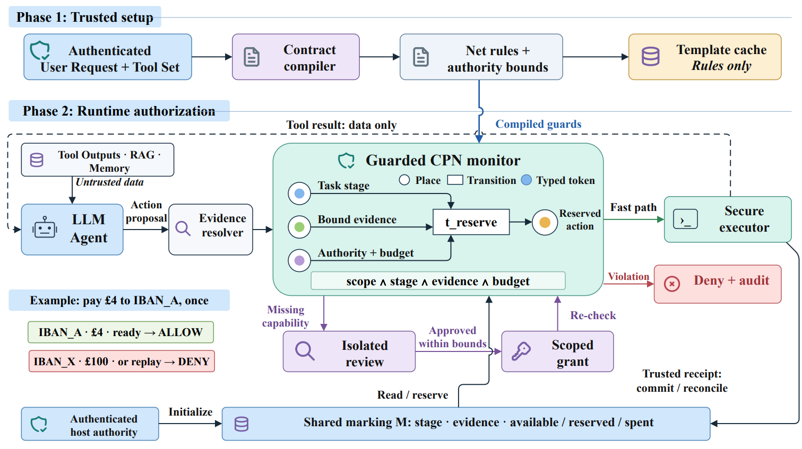

# ToolFence

Anonymous source repository for paper: ''ToolFence: Fine-Grained Authorization for Secure Tool-Using LLM
Agents`` reorganised and modified from the original implementation.
This project implements a capability-authorisation and transaction-ledger defence layer for tool-using agents, including a policy compiler, parameter provenance checking, dynamic capability granting, persistent transaction accounting, and targeted test suites.

> This repository contains no non-public data, credentials, or model weights.

<p align="center">

<br>
<em>Figure: ToolFence runtime and authorisation boundary overview</em>
</p>

## Overview
ToolFence enforces bounded, auditable tool execution for LLM agents. It separates policy compilation, runtime monitoring, and capability approval from the agent itself, using:
- typed tool manifests and fixed trusted catalogues
- isolated semantic policy compilation
- atomic transaction reservations, receipts, and reconciliation
- deterministic fast-path checks + guarded dynamic capability authorisation
- strict provenance rules for derived parameter bindings
- a ledger-backed execution boundary independent of online model services

AgentDojo is only used as an external benchmark framework; the core ledger and authorisation logic do **not** depend on it.

## Repository Structure

| Location | Corresponding Mechanism |
|----------|-------------------------|
| `src/toolfence/guarded_net.py`, `transaction_net.py` | Workflow stages, capability & evidence transaction ledger; atomic reservation, trusted receipts, dynamic authorisation proposals, intra-task authorisation |
| `src/toolfence/semantic/` | Isolated policy compiler, typed tool catalogues & capabilities, concrete parameter and provenance validation |
| `src/toolfence/hybrid/` | Deterministic fast path, dynamic capability authorisation, cross-session capability shape cache |
| `src/toolfence/runtime.py`, `colored_runtime.py`, `agentdojo_defense.py` | Agent runtime and final guarded ledger execution boundary |
| `src/toolfence/judge/`, `core/`, `foundation/` | Isolated reviewer, shared monitoring logic and foundational authorisation structures |
| `experiments/` | Host sandbox examples that do not depend on models |
| `tests/unit/` | Regression tests for transactions, parameter provenance, dynamic authorisation and paper-mode behaviour |

## Installation
Requires Python 3.10 or newer.

```bash
# editable install with test dependencies
python -m pip install -e '.[test]'

# run unit test suite
python -m pytest -q tests/unit
```

Import:

```
import toolfence
```

Full tests require AgentDojo for benchmark boundary integration. Either install AgentDojo into your environment or provide it via `PYTHONPATH`. Core functionality works without AgentDojo.

## Sandbox Examples

These examples do not invoke LLMs or real external tools. They validate mechanism behaviour only and do **not** measure prompt injection success rates.

```
python experiments/run_guarded_net_cases.py --output output/guarded-example
python experiments/run_refinement_cases.py --output output/refinement-example
```

## Core Concepts

The `strict_capabilities=True` mode changes behaviour for high-assurance defence:

1. Capability authorisation failures reject the call; no fallback to ad-hoc LLM approval.
2. `SemanticPolicyCompiler` uses a pinned `ToolManifest` and validates exact name/parameter matches against the trusted catalogue. Model-generated effect labels are overridden by the controller manifest.
3. `DERIVED` bindings must point to a single named output field from a single upstream tool. Ambiguous or unstructured provenance cannot authorise sensitive parameters.
4. Automatic local read exemptions are narrow: only host-reviewed local reads with `external_disclosure=False` and `mutates_state=False`. All parameters must be justified by the original user request.
5. Cross-session caches store only capability approval signatures (no concrete values), keyed by policy revision. New task parameter bindings are always revalidated.

## Trusted Host Integration

To attach ToolFence to your agent host:

1. Define a trusted tool catalogue and `ToolManifest`. Mark each tool’s operation, side effects, and privilege-affecting parameters.
2. Instantiate `SemanticPolicyCompiler` with your pinned manifest. The compiler must only see authenticated user requests and the trusted catalogue.
3. Create an isolated `RuntimeJudge` for runtime capability adjudication.
4. For each authenticated task, the host issues a precise `TaskContract`, configures `TransitionRule`, `EvidenceStep`, and `HostToolBinding` inside `GuardedTransactionNet`.
5. Build a `ToolFenceAuthorizationBoundary` referencing the trusted catalogue, transaction net, host bindings, actor, reviewer, and policy revision.
6. All tool calls flow through the semantic monitor **and** the transaction ledger.

If a complete `TaskContract` is missing, `GuardedBoundary(refine_missing=True)` creates a pending `RefinementProposal` rather than granting access. The host must call `review_refinement`; after approval, the agent resubits the call. Operations with uncertain outcomes stay reserved until reconciliation.

> 
> Important: Controller APIs (`issue`, `configure`, `ingest`, `activate`, `review_refinement`, `reconcile`) are administrative interfaces and must **never** be exposed as agent tools. Model outputs or tool returns alone are not trusted evidence.

## Anonymity Statement

The published package and source tree contain:

- no author, institutional, or version-history metadata
- no host filesystem paths, secrets, persisted ledgers, or private caches
- only fictional names/emails in test fixtures

## Reference
If you use this implementation, please cite:
```bibtex
@misc{li2026toolfencefinegrainedauthorizationsecure,
      title={ToolFence: Fine-Grained Authorization for Secure Tool-Using LLM Agents}, 
      author={Yanjie Li and Yiming Cao and Bin Xiao},
      year={2026},
      eprint={2609.37196},
      archivePrefix={arXiv},
      primaryClass={cs.CR},
      url={https://arxiv.org/abs/2609.37196}, 
}
```

## License

> This project is licensed under the MIT License.

Copyright (c) 2026

